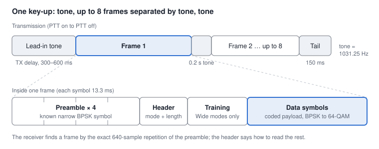

# SARA FM Protocol Specification

November 6, 2026 · PAREDN (DW1IRF)

SARA FM is an open OFDM sound-card modem for VHF/UHF FM radios that carries AX.25 packet (BPQ32, Winlink Express) and its own chat and ping frames. This document describes everything a second, independent implementation needs to talk to it over the air, as of SARA FM 0.9.79.

## 1. Scope and status

- **Purpose.** Public documentation of the on-air format, so that SARA FM signals can be decoded by anyone and the mode meets the amateur-radio requirement for publicly documented data modes (US Part 97; Philippine NTC rules for amateur stations).
- **Covers.** The audio waveform, coding, frame formats, the payloads carried inside frames, link adaptation, channel access, and the two host-side TCP interfaces.
- **Version.** Reference implementation SARA FM 0.9.79 (PAREDN, November 2026). Frame formats are versioned so later versions stay compatible; section 10 lists what a receiver must accept.
- **License and use.** The protocol is open: anyone may implement it, in any language, without permission or fee. The reference implementation is licensed under the GNU General Public License v3.0 or later (GPL-3.0-or-later); this specification is licensed under Creative Commons Attribution 4.0 International (CC BY 4.0).
- **No encryption.** Nothing is encrypted or scrambled. Callsigns travel in clear ASCII in every frame type. Chat text may be zlib-compressed (RFC 1950), which is a public, documented algorithm.
- **Conventions.** All multi-byte integers are big-endian unless stated. Bit order within a byte is most significant bit first. "dBFS" is relative to sound-card full scale.

## 2. System overview

SARA FM is a modem, not a protocol stack: it moves frames handed to it by host software and does no retransmission of its own. Reliability for packet traffic comes from AX.25 in the host (BPQ32 or Winlink Express); SARA FM adds forward error correction so fewer frames need retrying.

The layers, top to bottom:

1. **Host application** — Winlink Express, BPQ32, or any KISS client. Runs AX.25 connected mode (SABM, I-frames, RR/REJ, retries).
2. **KISS over TCP** (section 8) — frames cross between host and modem, optionally with KISS ACKMODE.
3. **SARA FM payloads** (section 5) — AX.25 frames packed into a batch; or a SARA ping/pong; or a SARA Chat frame. Each payload is one OFDM frame.
4. **Coding** (section 4) — CRC-16, Reed-Solomon, and in the coded modes a convolutional code with interleaving.
5. **OFDM waveform** (section 3) — 48 kHz audio, 16 or 22 carriers between 469 Hz and 2.6 kHz, BPSK to 64-QAM.
6. **Radio** — an ordinary FM transceiver keyed by PTT (CM108 GPIO, serial, or VOX), audio through its mic/speaker or data port.

Other design rules:

- **Self-describing frames.** Every frame says its own modulation in its header; the two stations never have to be set to the same mode.
- **Per-direction speed.** Each station picks the transmit mode for each neighbour from that neighbour's reports (section 6). The two directions of a link can run different modes.
- **Several frames per key-up.** Queued frames go out in one transmission (a burst), separated by a steady tone so the channel never sounds idle mid-burst (section 7).

## 3. Physical layer

One OFDM frame is 4 preamble symbols, 1 header symbol, (in Wide modes) 1 training symbol, then the data symbols, all at 75 symbols per second on a 48 kHz audio stream.

### 3.1 OFDM parameters

| Parameter | Value |
| --- | --- |
| Sample rate | 48 000 Hz |
| FFT size | 512 samples (carrier spacing 93.75 Hz) |
| Cyclic prefix | 128 samples (last 128 samples of the symbol, prepended) |
| Symbol length | 640 samples = 13.333 ms (75 symbols/s) |
| Narrow carriers | FFT bins 5–20: 16 carriers, 468.75–1875 Hz. Pilots at positions 0, 5, 10, 15; 12 data carriers |
| Wide carriers | FFT bins 7–28: 22 carriers, 656.25–2625 Hz. Pilots at positions 0, 7, 14, 21; 18 data carriers |
| Pilot value | +1 + 0j on every symbol |
| Real signal | Each carrier value v at bin k is placed at k and its conjugate at 512 − k; IFFT real part |
| Per-symbol scaling | Each symbol is scaled to peak 1.0, then the whole frame is scaled to peak 1.0 |
| Edge taper | Linear ramp of 72 samples (1.5 ms) at the start and end of the frame only |

"Position" counts carriers from the lowest bin of the set (position 0 = bin 5 in narrow, bin 7 in Wide). Data carriers are the non-pilot positions in increasing order.

### 3.2 Frame structure

1. **Preamble:** the same known narrow symbol sent 4 times back to back. Carrier i (positions 0–15) is BPSK of bit i of `1100111000001000` (bit 0 → +1, bit 1 → −1). Receivers detect frames by the exact 640-sample repetition.
2. **Header:** one narrow BPSK symbol. Its 12 data carriers carry 12 bits, MSB first: 2 bits header code, then 10 bits on-air length (bytes after Reed-Solomon, 1–1023). Pilots as above. The header has no FEC of its own; a bad header is caught because the frame then fails its length checks or CRC.
3. **Training symbol (Wide modes only):** one known BPSK symbol on all 22 Wide carriers. Base pattern (position 0 first): `1010011101011000111111`. Each Wide mode flips it with its own pattern (table 3.3), so the receiver learns the exact mode from which pattern fits.
4. **Data symbols:** the coded bits (section 4) fill the data carriers in position order, symbol after symbol; the last symbol is padded with 0 bits.

### 3.3 Modulations

| Mode | Header code | Carriers | Training flip f(i) | Bits per carrier | Data bits per symbol | Gross rate |
| --- | --- | --- | --- | --- | --- | --- |
| BPSK | 0 | Narrow | — | 1 | 12 | 900 bit/s |
| QPSK | 1 | Narrow | — | 2 | 24 | 1 800 bit/s |
| QPSK Wide | 3 | Wide | 0 | 2 | 36 | 2 700 bit/s |
| 16QAM Wide C (coded 2/3) | 2 | Wide | (i div 2) mod 2 | 4 | 72 | 3 600 bit/s |
| 16QAM Wide | 2 | Wide | 0 | 4 | 72 | 5 400 bit/s |
| 64QAM Wide C (coded 3/4) | 2 | Wide | (i mod 2) XOR ((i div 2) mod 2) | 6 | 108 | 6 075 bit/s |
| 64QAM Wide | 2 | Wide | i mod 2 | 6 | 108 | 8 100 bit/s |

Training bit i = base bit i XOR f(i). Gross rate = data bits per symbol × 75, after the convolutional code where there is one, before Reed-Solomon, CRC and the preamble/header/training overhead.

The four modes sharing header code 2 are told apart only by the training symbol. A station must not send 64QAM or a coded mode to a receiver that has not announced it decodes them (capability bits, section 5.2).

### 3.4 Constellations

- **BPSK:** bit 0 → +1, bit 1 → −1.
- **QPSK:** bits (b0, b1) per carrier; I = +1 if b0 = 0 else −1, Q likewise from b1; scaled by 1/√2.
- **16-QAM:** bits (b0, b1, b2, b3) per carrier; I from (b0, b1) and Q from (b2, b3) with (0,0) → −3, (0,1) → −1, (1,1) → +1, (1,0) → +3; scaled by 1/√10.
- **64-QAM:** bits (s, a, c) per axis, I first then Q; sign + if s = 1; magnitude (1,0) → 1, (1,1) → 3, (0,1) → 5, (0,0) → 7; scaled by 1/√42.

The header, preamble and training symbols are always BPSK.

## 4. Coding and framing

Every payload gets a CRC-16, then Reed-Solomon parity in interleaved blocks; the two coded Wide modes add a convolutional code and a bit interleaver on top.

### 4.1 Transmit order

1. **CRC:** append CRC-16/CCITT-FALSE of the payload (polynomial 0x1021, initial value 0xFFFF, no reflection, no final XOR), 2 bytes, big-endian.
2. **Reed-Solomon:** split payload + CRC into the fewest blocks of at most M data bytes, sized as evenly as possible (the first blocks get the extra byte). M = 231 in narrow modes, 160 in Wide modes. Encode each block with RS over GF(2^8): field polynomial 0x11D, generator α = 2, first consecutive root α^0, 24 parity bytes per block (corrects up to 12 byte errors per block), systematic, shortened.
3. **Byte interleave:** on-air byte order is block0\[0\], block1\[0\], …, block0\[1\], block1\[1\], … (a shorter block simply runs out first).
4. **Header length:** the header's 10-bit length is this on-air byte count. A receiver recovers the data length as the unique d with d + 24 × blocks(d) = on-air length; a length with no such d is invalid.
5. **Bits:** each byte MSB first.
6. **Coded modes only:** convolutional code and interleaver (4.2) applied to that bit stream.
7. **Map** to carriers (section 3.2, step 4).

The receiver reverses these steps and accepts the frame only if the CRC matches after correction.

### 4.2 Convolutional code (16QAM Wide C, 64QAM Wide C)

- **Code:** constraint length K = 7, generators 171 and 133 (octal), the code used by IEEE 802.11a. The shift register holds the current input in its most significant position; outputs per input bit are g171 then g133.
- **Termination:** 6 zero tail bits appended to the input.
- **Puncturing** (per input step t, 1 = sent, outputs in order g171, g133):

| Rate | Used by | Pattern, repeating |
| --- | --- | --- |
| 2/3 | 16QAM Wide C | t0: both · t1: g171 only |
| 3/4 | 64QAM Wide C | t0: both · t1: g171 only · t2: g133 only |

- **Bit interleaver:** let L = data bits per OFDM symbol for the mode (72 or 108) and n = number of coded bits. Number the positions of an R × L array (R = ⌈n / L⌉) row by row, then list them column by column, skipping any number ≥ n; call that list perm. Coded bit i is sent at on-air bit position perm\[i\]. Neighbouring coded bits thus land on different carriers and different symbols.
- Receivers are free to decode with hard or soft decisions; the reference implementation uses max-log soft demapping and soft Viterbi.

### 4.3 Size limits

| Limit | Value | Why |
| --- | --- | --- |
| On-air bytes per frame | 1 023 | 10-bit header length |
| AX.25 batch, narrow modes | about 250 bytes | measured margin against sound-card clock drift |
| Chat frame, narrow / fast modes | 320 / 680 bytes | same, measured per mode family |
| Frames per key-up | 8 | keeps the channel shared |

## 5. Payload types

A frame's payload is one of three things, told apart by its first bytes: an AX.25 batch (0x01 + count), a ping/pong (type 1 or 2 followed by two callsign fields), or a SARA Chat frame (0xC5 0x43).

| First bytes | Payload | Passed to the KISS host? |
| --- | --- | --- |
| 0x01, count, then 2-byte lengths | AX.25 batch (5.1), optional link report (5.2) | Yes, the AX.25 frames |
| 0x01 or 0x02, then two space-padded callsigns | Ping / pong (5.3) | No |
| 0xC5 0x43 | SARA Chat (5.4) | No |

A batch and a ping both start with 0x01. They are told apart by byte 2: in a batch it is the high byte of a frame length (0x00 or 0x01); in a ping it is the first character of a callsign. A receiver treats a payload as a ping/pong only if it has an allowed length and both callsign fields match `^[A-Z0-9][A-Z0-9/-]{0,8} *$` (the destination may also be `*` + 8 spaces).

### 5.1 AX.25 batch

`0x01 | count (1 byte) | { length (2 bytes) | AX.25 frame } × count | [link report]`

Each AX.25 frame is the frame as KISS carries it: address field, control, PID and information, without flags, bit stuffing or FCS (the OFDM CRC replaces the FCS). A batch holds the frames the host queued together, normally in one direction of one session.

### 5.2 Link report trailer

Any batch may end with a report on how the sender hears the station it is sending to. Receivers find it after the counted frames.

| Bytes | Field |
| --- | --- |
| 0–1 | Magic 0xA5 0x52 |
| 2 | Report version, 1 |
| 3 | Mode (section 3.3 internal number) of the frames reported on |
| 4 | Frames received intact (0–255) |
| 5 | Frames lost (0–255) |
| 6 | Median preamble S/N, dB, signed |
| 7 | Worst frame's FEC use, % of capacity (0–100) |
| 8 | Average FEC use, % |
| 9 (optional) | Capability bits of the SENDER: 0x01 decodes 16-QAM Wide, 0x02 decodes 64-QAM Wide, 0x04 decodes the coded Wide modes |
| 10 (optional) | Median data-carrier S/N, dB, signed; 0x80 = not measured |

Internal mode numbers: BPSK 0, QPSK 1, 16QAM Wide 2, QPSK Wide 3, 64QAM Wide 4, 16QAM Wide C 5, 64QAM Wide C 6. Readers must ignore bytes after those they know.

### 5.3 Ping and pong

| Bytes | PING | PONG |
| --- | --- | --- |
| 0 | 1 | 2 |
| 1 | Sequence number (0–255) | Same sequence number as the ping |
| 2–10 | From callsign, ASCII, space-padded to 9 | From callsign |
| 11–19 | To callsign, or `*` for anyone | To callsign |
| 20 (optional) | Flags: 0x01 report carrier S/N, 0x02 answer quieter | S/N of the received ping, dB, signed |
| 21 (optional) | — | Raw input level of the ping, dBFS, before the responder's RX gain, signed |
| 22 (optional) | — | Data-carrier S/N of the ping, dB, signed (0x80 = not measured); only when flag 0x01 was set |

Valid lengths are 20 to 23 bytes. A flags byte of 0, or with unknown bits, is invalid.

### 5.4 SARA Chat

`0xC5 0x43 | version 1 | type | left | from (length byte + UTF-8) | to (length byte + UTF-8) | body`

`left` = how many more chat frames follow in the same transmission (0 on the last). The NET room's address is `*NET`. Callsigns ending in `-0` are the same as the bare callsign.

| Type | Name | Body |
| --- | --- | --- |
| 1 | Message | id (2), flags (1), Unix time (4), text: UTF-8, zlib-compressed when flag 0x01 is set. Flags: 0x02 NET, 0x04 CQ, 0x08 check-in, 0x10 was held |
| 2 | Receipt | count n (1), S/N of the last frame heard (1, signed), n message ids (2 each), then optional extras: a link report (5.2) and the feature marker 0xC5 0x56 0x02 (takes multi-piece frames) |
| 3 | File offer | id (2), file id (2), size (4), piece count (2), CRC-32 of the file (4, zlib), name (length byte + UTF-8) |
| 4 | File piece | id (2), file id (2), piece index (2), data |
| 5 | File pieces | count (1), then per piece: id (2), file id (2), index (2), length (2), data |

A receiver answers direct messages and file frames with a receipt listing their ids; the sender resends what is not receipted after 12 s, up to 4 times for messages and 8 for file pieces. Messages to `*NET` are sent once and not receipted. Type 5 may be sent only to a station whose receipts carry the feature marker.

## 6. Link adaptation

Each station chooses its transmit mode per neighbour from that neighbour's link reports (5.2); this section is informative, because any choice is decodable as long as the receiver's capability bits allow it.

The reference implementation climbs one rung at a time up this ladder, skipping rungs the receiver has not announced:

| Mode | Step up to it when reported S/N ≥ | and data carriers ≥ | Step down from it when S/N < | or data carriers < |
| --- | --- | --- | --- | --- |
| BPSK | (start / fallback) | — | — | — |
| QPSK | 15 dB | — | 11 dB | — |
| QPSK Wide | 21 dB | — | 16 dB | — |
| 16QAM Wide C | 20 dB | 15 dB | 16 dB | 12 dB |
| 16QAM Wide | 27 dB | 19 dB | 20 dB | 14 dB |
| 64QAM Wide C | 30 dB | 20 dB | 24 dB | 17 dB |
| 64QAM Wide | 33 dB | 24 dB | 28 dB | 20 dB |

Other rules:

- **Up:** two clean reports in a row (no lost frames, every frame used at most 25% of its FEC), and at least 30 s since the last step down.
- **Down:** any lost frame, a frame that used 60% or more of its FEC, or S/N or carriers under the thresholds above. Further step-downs are ignored for 8 s.
- **Strong signal:** losses reported at 24 dB S/N or more never push the mode below QPSK; such losses come from collisions or distortion, which a slower mode does not fix.
- **Probe:** after 45 s in a slower mode with a strong signal, try one rung up.
- **No reports** (an older peer): step back up after 90 s without losses.
- **New connection:** start at QPSK; if the last session with that station ended cleanly a short time ago, start one rung below the mode it ended in instead.
- **64-QAM and the coded modes** are sent only to stations whose capability bits include them, and 64-QAM only when the user has enabled it.

## 7. Channel access

A SARA FM transmission is never silent while the transmitter is keyed: a steady 1031.25 Hz tone fills the lead-in, the gaps between frames and the tail, so other stations' carrier sense sees the channel busy for the whole key-up.

### 7.1 One transmission

1. **Carrier sense** (below) finds the channel clear; a short random delay and a re-check follow.
2. **PTT on**, then the **lead-in tone** for the station's TX delay (typically 300–600 ms; the radio's keying and the far squelch need this).
3. **Frame**, then 0.2 s of tone, then the next frame, up to 8 frames.
4. **Tail tone** of 150 ms, **PTT off**.

The fill tone is a sine at 1031.25 Hz, amplitude 0.45 × the transmit level (about the data's own RMS). That frequency is chosen so the tone never correlates with itself at the 640-sample preamble lag, and so is never mistaken for a preamble.

### 7.2 Carrier sense (DCD)

- **SARA-PP signals only** (default): the channel is busy while SARA FM energy is present: the fill tone, a preamble, or a frame being decoded, and for a short hold after it. Speech or other modes on the channel are waited out for at most 8 s.
- **Auto:** busy also on any audio well above the measured noise floor (6 dB margin).
- **Off:** transmit without sensing (used for test only).
- After receiving a frame addressed to it, a station gives the sender up to 2.5 s to continue before replying. Pings, pongs and tuning ignore DCD.

### 7.3 Digipeating

A station with the digipeater enabled repeats an AX.25 frame whose next unrepeated digipeater entry is its own callsign (any SSID it uses) or a configured alias. It sets that entry's H bit (replacing an alias with its own callsign), waits for 1.2 s of clear channel, and transmits the frame unchanged otherwise, in the mode it uses towards the next hop. Repeating is plain AX.25 digipeating; there is no SARA-specific relay protocol.

The reference implementation also has gateway-side behaviour that changes only what is handed to the host, not what is sent on the air. One example: it shows a caller that arrived through a digipeater to BPQ32 as a direct connection and adds the path back on replies.

## 8. Host interfaces

These interfaces run on the station's own computer or network and never appear on the air; they are documented so other software can use a SARA FM modem.

### 8.1 KISS over TCP

- **Transport:** the modem listens on TCP, default port 8105 (configurable), one client at a time. By default only the same computer may connect; with network access enabled, the allowed addresses are a list, by default private ranges (10/8, 172.16/12, 192.168/16, Tailscale 100.64/10, loopback).
- **Framing:** standard KISS: FEND 0xC0, FESC 0xDB, TFEND 0xDC, TFESC 0xDD. The command byte's high nibble is the port (0), the low nibble the command.
- **Data (0x00):** one AX.25 frame without FCS, in either direction.
- **ACKMODE (0x0C):** as in BPQ32: the client sends `0x0C | 2-byte id | frame`; the modem sends back `0x0C | same id` when that frame has actually been transmitted, so the host times its AX.25 retries from the real transmit moment.
- Other KISS commands (TXDELAY, persistence, slot time) are accepted and ignored; the modem manages channel access itself.
- The modem passes the host every AX.25 frame it decodes, including other stations' traffic, as a TNC would. It does not pass pings, pongs or chat frames.

### 8.2 Remote chat (TCP)

A station may let operators on other computers chat through its radio. The station listens on TCP, default port 8180, using the same allowed-address list; several operators may be connected. Each message is one line of UTF-8 JSON.

| Direction | Message | Fields |
| --- | --- | --- |
| Operator → station | `hello` | `call`: the operator's callsign; `ver`: 1 |
| Operator → station | `tx` | `id`: request number; `p`: a chat frame (5.4), base64; `peer`; `attempt` |
| Operator → station | `report` | `peer`; `x`: a link report (5.2) from a receipt, base64 |
| Station → operator | `welcome` | `station`: the station's callsign; `ver` |
| Station → operator | `state` | `can_send`: whether the radio is free (on change and every 2 s) |
| Station → operator | `sent` | `id`: that frame is on the air; `mode` |
| Station → operator | `rx` | `p`: a chat frame heard, base64; `snr`; `mode` |
| Station → operator | `heard` | `call`, `snr`, `mode`, `how`: a station heard by ping or packet |

The operator's own software runs the chat logic (receipts, resends, held messages); the station only carries frames and picks the transmit mode. Frames between people connected to the same station are passed locally and not transmitted. Remote operators transmit under their own callsigns, which appear in every chat frame.

## 9. Station identification and regulatory notes

Every SARA FM frame that carries traffic names its sender in clear text, so any listener with this document can tell who transmitted.

- **AX.25 batches** carry the AX.25 source address (ASCII shifted left one bit, per AX.25 2.2) of every frame.
- **Pings and pongs** carry both callsigns as plain ASCII.
- **Chat frames** carry the sender's and addressee's callsigns as plain UTF-8.
- **Not encrypted:** no field is encrypted or scrambled. The only transformation is optional zlib compression of chat text, a public algorithm (RFC 1950), flagged per message.
- **Occupied audio band:** 469–2625 Hz (Wide modes) or 469–1875 Hz (narrow modes) plus the 1031.25 Hz fill tone, sent through an ordinary voice FM transmitter; the RF bandwidth is that of the radio's normal FM voice emission.
- **Operators** remain responsible for their own national rules on data emissions, identification intervals and third-party traffic. This document is the public description of the mode that those rules may require.

## 10. Versioning, compatibility and reference implementation

New features are added so that older receivers either ignore them or reject them cleanly, never misread them; a new implementation should follow the same rules.

- **Modes:** a receiver that does not know a header code or training pattern rejects the frame. A sender uses 16-QAM, 64-QAM and the coded modes only after the receiver's link report announces them (capability bits, 5.2).
- **Reports and pings:** fields are only ever appended. Readers take the fields they know and ignore the rest; report version 1 is current.
- **Chat:** frame version 1. Optional extras ride at the end of a receipt; multi-piece file frames are sent only after the receiver's feature marker.
- **Reference implementation:** SARA FM 0.9.79 (Python 3.11, NumPy, SciPy). Its `ofdm_core.py`, `fec.py`, `fec_cc.py`, `protocol.py`, `bpq_bridge.py`, `link_adapt.py` and `chat.py` are the normative code for anything this document leaves unclear, and its offline test suite (`test_offline.py`, 728 checks) encodes and decodes every mode.

### Before publishing

- [x] License chosen: GPL-3.0-or-later for the code, CC BY 4.0 for this specification
- [x] Repository: [github.com/PAREDN/sara-fm](https://github.com/PAREDN/sara-fm)
- [x] Test vectors: 20 recordings in `test-vectors/` (every mode clean and with noise, multi-block Reed-Solomon, ping, pong, chat, batch with link report), each with its bytes at every coding stage; `test-vectors/verify.py` checks them
- [ ] Have a second person check sections 3–5 against the code and the test vectors

---

Copyright © 2026 PAREDN. This specification is licensed under the [Creative Commons Attribution 4.0 International License](https://creativecommons.org/licenses/by/4.0/).
